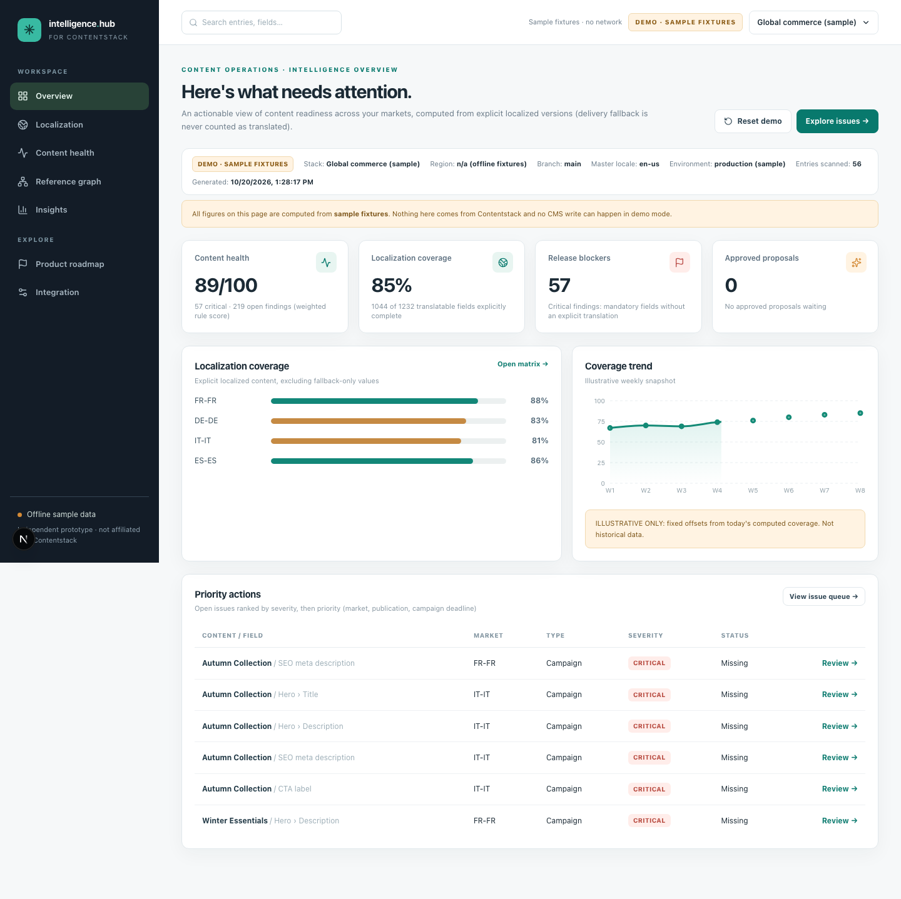

# Contentstack Intelligence Hub

A cross-market **content operations control plane** for Contentstack: find missing, incomplete, possibly stale and unpublished localized content at **field level**, see what an edit could break across references, and make AI translation fixes **reviewable and auditable**.

Independent prototype built for a job interview (21 Oct 2026). It complements Contentstack's native localization, workflow and analytics; it is **not affiliated with Contentstack**.

**Stack:** Next.js 16 (App Router) · TypeScript (strict) · Tailwind 4 · shadcn-style UI (Radix) · Recharts · d3-force/zoom · TanStack Table · Zod · Vitest · Playwright.



## Features

| Page | What it does |
|---|---|
| **Overview** | Health score, coverage, release blockers, pending approvals, per-locale coverage, priority queue, real scan-history trend (live) |
| **Localization** | Locale × content-type coverage matrix, filterable/sortable issue queue, CSV export, bulk dry-run, **review drawer** (source / existing / editable AI proposal, validation, audit trail) |
| **Content health** | Transparent rule list, score breakdown with the exact formula, severity/rule filters, evidence and remediation |
| **Reference graph** | Interactive force graph of entries and assets: **blast radius** before an edit, dependencies, hubs, broken references, orphans |
| **Insights** | Issues by market, coverage by type, AI operations (acceptance rate, cost), clearly-marked future GA4/commerce stub |
| **Roadmap** | The 10 product modules with native-overlap notes and prototype boundaries |
| **Integration** | Connect & diagnose Contentstack, check OpenAI model access, write-safety and policy status |

Live mode shows `LIVE · Contentstack`, demo mode shows `DEMO · Sample fixtures`; every page states which one you are looking at, the stack/region/branch and the scan time. Live items deep-link into the Contentstack web app.

## Run

```bash
npm install
cp .env.example .env.local        # fill secrets locally; never commit, never paste into chat
npm run dev                        # http://localhost:3000  → /overview
```

- **Demo (offline, no credentials):** choose *DEMO · Sample fixtures* in the stack menu (top right). 5 locales, 4 content types, 56 entries.
- **Live:** set `CONTENTSTACK_API_KEY`, `CONTENTSTACK_MANAGEMENT_TOKEN`, and `CONTENTSTACK_API_BASE_URL` (must match the stack's **hosting region**), then *Integration → Connect & diagnose* and *Scan Contentstack*.
- **Live AI:** set `OPENAI_API_KEY`, `OPENAI_MODEL`, optionally `OPENAI_REASONING_EFFORT`, and `AI_SEND_CONTENT_TO_OPENAI=true` only if the content may go to OpenAI. Then *Integration → Check OpenAI model access*.

### Configuration (`.env.local`, see `.env.example`)

| Variable | Purpose |
|---|---|
| `DATA_MODE` | `live` (default when configured) or `demo` |
| `CONTENTSTACK_API_BASE_URL` / `CONTENTSTACK_REGION` | Allowlisted CMA host (na, eu, au, azure-na, azure-eu, gcp-na, gcp-eu). Arbitrary URLs are rejected |
| `CONTENTSTACK_API_KEY`, `CONTENTSTACK_MANAGEMENT_TOKEN`, `CONTENTSTACK_BRANCH`, `CONTENTSTACK_ENVIRONMENT` | Read access, branch, and environment for publication checks |
| `OPENAI_MODEL`, `OPENAI_REASONING_EFFORT` | Model and effort. **Effort is read from env only** and recorded on every proposal with reasoning tokens |
| `OPENAI_PRICE_INPUT_PER_MTOK`, `OPENAI_PRICE_OUTPUT_PER_MTOK` | USD per 1M tokens, taken from OpenAI's pricing page for your model. Unset ⇒ cost shows `—`, never `$0`. Cached-input discounts are not modelled |
| `AI_SEND_CONTENT_TO_OPENAI` | Must be `true`, plus per-field consent in the UI, before any CMS text is sent |
| `ENABLE_CMS_WRITES`, `CONTENTSTACK_WRITE_TOKEN`, `CMS_WRITE_ALLOWED_ENTRY_UIDS` | All three are required for the guarded draft write. Default: off |
| `ENABLE_CMS_PUBLISH` | Ignored. Publishing does not exist in this build |
| `SCAN_MAX_ENTRIES_PER_TYPE`, `CRITICAL_LOCALES`, `HUB_ACTOR_ID` | Scan bound (disclosed in the UI), priority markets, reviewer identity for the audit trail |

## What is real, what is simulated

| Piece | Status |
|---|---|
| Contentstack CMA reads (locales, content types, entries, explicit `/locales` presence, publish details, references) | **Real**, read-only, server-side, verified against a live EU stack |
| Coverage / health / issue rules / graph | Real computation over whichever dataset is loaded |
| OpenAI proposals | **Real** when configured and consented. Code is verified against a mocked Responses API; run it with your own key to verify live |
| DEMO data and DEMO proposals | **Simulated** (sample phrase bank), always labelled |
| "Apply to demo" | Changes only the local demo overlay (`.data/demo.json`) |
| Live CMS draft write | Implemented as a guarded, single-field, draft-only writer; **disabled by default**; unit-tested with mocks; see *Safety model* |
| Publishing | **Does not exist** |
| Trend chart | Live: recorded scan history. Demo: labelled *illustrative* |
| GA4 / BigCommerce impact | Not implemented; clearly marked future |

## Safety model

- Secrets only in `.env.local`, read in server modules. Nothing uses `NEXT_PUBLIC_`; `/api/status` returns booleans/labels only; errors never include headers.
- CMA hosts are allowlisted by region; the browser cannot supply URLs.
- Mutating routes require same-origin and an `x-hub-request` header. **This is not user authentication**: it is a single-user local prototype. Production needs real sessions, roles and per-actor permissions.
- **Approve ≠ write ≠ publish.** Approval needs non-empty text, no placeholder/markup mismatch, and an unchanged source fingerprint (409 otherwise).
- Guarded writer requirements: `ENABLE_CMS_WRITES=true`, a separate write token, the entry in `CMS_WRITE_ALLOWED_ENTRY_UIDS`, explicit confirmation in a modal, fresh re-read, fingerprint + version check (409 on conflict), single-field merge with assets sent as UIDs, read-back verification before a proposal becomes `written`. A pre-read is **not** an atomic compare-and-swap. After a conflict the reviewer can **re-review against the current CMS state**.
- The review panel lists exactly which write conditions are unmet.
- Review/audit state and the last live snapshot are stored as local JSON in `.data/` (gitignored). The live snapshot contains source/target text; delete `.data/` to purge.

## Modelling notes (what the real stack taught us)

- Existence, completeness, freshness, publication and proposal state are separate fields.
- Delivery fallback is never counted as localized; `/locales` `localized: true` is the source of truth.
- **Instance IDs can differ between locales** (fr-fr blocks/groups had different `_metadata.uid`s). Fields match by UID first, then by position, and the evidence says so.
- **Contentstack drops blank items from multi-value text fields**, so those arrays compact. The restore script re-inserts them by index.
- Freshness is `unknown` unless an approval baseline exists (created when you approve a proposal). Never guessed.
- "Identical to source" is flagged as *possibly untranslated*; product names may legitimately be unchanged, so a reviewer decides.
- Policy exclusions (identifier-like fields, enums, non-localizable fields) are disclosed in the UI.
- Updates to the CMA must send assets as UIDs, not full asset objects (`"is not a valid upload"`).

## Reference Impact Graph (`/graph`)

Entries, the entries they reference and the assets they use, from reference fields, JSON RTE embeds and file fields, including inside groups, blocks and global fields. Pan/zoom, draggable nodes, search, content-type filters, and two highlight modes: **Blast radius** (everything that transitively references the selected entry, coloured by hop distance, cycle-safe) and **Dependencies**. The side panel gives counts, ranked dependents, the entry's open localization issues and a Contentstack deep link, and lists **hubs**, **broken references** (only for fully scanned content types) and **entries nothing references**.

Limits: references are read from master-locale entries; "not referenced" does not mean unused (pages are reached by URL); capped or failed content types show targets as *unverified*, never broken; the layout runs in the browser, so very large stacks would need server-side graph pagination.

## Maintenance scripts (live stack)

These talk to the real stack with the management token and are separate from the app's safety model. All write drafts only and never publish. Backups are written to `backups/` (gitignored, contains real content).

```bash
npm run live:scan                                        # read-only smoke test, prints counts only
npm run cs:backup                                        # read-only: every en-us + fr-fr entry and the schemas
npm run cs:degrade  -- backups/<ts>                      # PREVIEW: blank ~10% of fr-fr text fields
npm run cs:degrade  -- backups/<ts> --apply              # write drafts + degrade-manifest.json
npm run cs:restore  -- backups/<ts>                      # PREVIEW restore from the manifest
npm run cs:restore  -- backups/<ts> --apply              # put the original values back (only if still blank; --force to override)
npx tsx scripts/diff-fr.mts backups/<ts>                 # read-only: what differs from the backup
```

`cs:degrade` exists to make gaps visible for demos. The manifest is written incrementally so a crash can still be restored, and `--apply` resumes safely.

## Quality

```bash
npm run verify      # lint → typecheck → unit/integration tests → build
npm run test        # Vitest: scoring, fallback semantics, freshness, state machine, validation,
                    #         CMA pagination/retry/partial failure, write guards, OpenAI provider (mocked),
                    #         reference graph, deep links, restore helpers
npm run e2e         # Playwright (demo mode): journey, reject, placeholder block, keyboard, filters/CSV, graph
                    #   E2E_PORT=3000 reuses a running dev server; PW_CHROMIUM_PATH reuses an installed Chromium
```

## 3-minute demo script

**Live-first (if the scan works):** 0:00 *Integration → Connect & diagnose* (real region/branch/locales) → Overview → *Scan Contentstack* (progress bar); point at the `LIVE · Contentstack` badge, scan time, coverage. 0:45 Localization → open a real finding; use the ↗ to jump to the entry in Contentstack. 1:15 Tick consent → *Generate proposal with OpenAI* → show model, effort, tokens, validation → edit a phrase → *Approve*. 2:15 "Approval is not a CMS write" (audit trail, write conditions listed). 2:30 *Reference graph*: click a hub, show the blast radius, then architecture and roadmap.

**Offline fallback:** 0:00 Switch to DEMO; KPIs and the sample-data banner. 0:30 Localization → click Italy / Campaign cell, status *Missing* → critical campaign field. 1:00 *Generate simulated proposal* → edit → *Approve*. 2:00 *Apply to demo dataset*. 2:30 KPIs recalculate; *Reset demo*; Reference graph (blast radius + the deliberate broken reference).

## Layout

`lib/domain` pure logic (rules, scoring, graph, review state machine, paths, deep links) · `lib/adapters` demo/live adapters, CMA client, guarded writer · `lib/scan` pipeline and view · `lib/ai` prompt, provider, validation, pricing · `lib/security` env, request guard, write policy · `lib/store` JSON store · `app/api` routes · `components/*` UI · `scripts/` live smoke test and maintenance scripts · `tests/` unit + integration · `e2e/` Playwright. See `PLAN.md`, `CLAUDE_HANDOFF.md`, `LIVE_INTEGRATION.md`.

## Known limitations

No authentication or database (local JSON; Postgres + real sessions are the production path) · live write path not exercised end-to-end against a stack · OpenAI path not exercised live unless you add a key · scan is bounded and in-process (no scheduler) · references are master-locale only · deep-link URL shapes follow the app's hash routes and were not click-tested on every plan/region.
