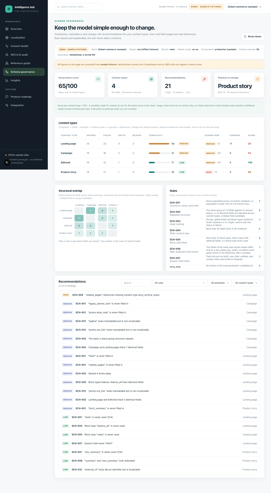

# Schema governance (`/schema`)

Complexity, redundancy and **change-risk** recommendations for your content types, computed from the schemas, **real field usage** across entries, and the **reference graph**. Everything is rule-based and explainable, and the tool never edits a schema.



## What goes in

All of it comes from the normal scan, with no extra API calls:

- **Schemas**: every content type, normalised (groups, global fields, modular blocks, references, localization flags).
- **Field usage**: for each schema path, how many master-locale entries hold a value. Group and block instances collapse to their schema path (`content.text.text`), so you see usage per *definition*, not per instance. Empty strings and untouched booleans do not count as filled.
- **Inbound references**: from the [reference graph](reference-graph.md), used for change risk.

## Metrics

```
complexity = fields + 4×maxDepth + 3×blockTypes + 2×groups + references     bands: low <25 ≤ medium <60 ≤ high
change risk = min(100, 1.5×entries + 2×inboundEntries + 8×inboundTypes)      bands: low <30 ≤ medium <60 ≤ high
type score  = max(0, 100 − Σ penalties)    high 15 · medium 8 · low 3          stack score = mean over types with fields
```

Depth counts groups, global fields **and** block types as levels (`content → text block → field` is depth 3). Change risk answers "how much would a breaking change touch?": entries that carry the change, entries elsewhere that reference this type, and (with several locales) the locales to re-check. A *breaking* change is removing, renaming or retyping a field, or changing localization settings.

## Rules

| Rule | Title | Severity | Detection logic |
|---|---|---|---|
| `SCH-001` | Unused or rarely used field | medium / low | Never populated across ≥5 entries (medium), or populated in under 10% of ≥10 entries (low) |
| `SCH-002` | Repeated structure | medium | The same group of ≥3 fields appears in several places, or ≥3 identical fields are repeated across content types: a Global Field candidate |
| `SCH-003` | Deep nesting | medium / high | Groups, global fields and block types nested 4+ levels (medium) or 5+ (high): hard to edit and heavy to deliver |
| `SCH-004` | Wide content type | low / medium | More than 25 fields (low) or 40 (medium) |
| `SCH-005` | Block type bloat | medium / low | More than 12 block types, block types with identical fields, or a block type never used |
| `SCH-006` | Near-duplicate field names | low | Two fields of the same type whose names differ only by a seo_/meta_/og_ prefix, so editors must guess which to fill (title/meta_title is exempt) |
| `SCH-007` | Generic field name | low | Field uid such as field1, new_field, untitled, test: unclear intent and brittle to integrate |
| `SCH-008` | Empty content type | low | No entries in the scanned branch: candidate for retirement (or a template not yet used) |
| `SCH-009` | Broken or broad reference | high / low | Reference field points at a content type that does not exist (high), or at more than 5 types (low) |
| `SCH-010` | Localization setting looks wrong | medium / low | Translatable-looking text (headline, description, label…) is non-localizable (medium), or an identifier (sku, id, slug, code…) is localizable (low). `title` is exempt (often an internal name) |
| `SCH-011` | Fragile core type | medium | High complexity combined with high change risk: changes here are expensive and need a migration plan |

A flagged container suppresses its children: an unused block type or a rarely used group produces **one** finding, not one per inner field. Thresholds are defaults in `lib/domain/schema-governance.ts` (`GOV`).

## The page

- **Content types** table: entries, fields, depth, block types, complexity bar, change-risk band, findings and score. Click a row for the type drawer.
- **Structural overlap** heatmap: shared identical fields (same name and type, excluding `title` and Global Field members) between every pair of types. Click a cell to see exactly which fields are shared. High overlap is a Global Field or merge candidate.
- **Recommendations**: every finding with evidence and a concrete recommendation, filterable by rule, severity and type.
- **Type drawer**: the full field tree with a usage bar per field (red = never filled), localization status (*localized* / *same in all*), mandatory markers, and a "if you make a breaking change here" box.

## Try it

```bash
npm run dev            # /schema in demo or live mode
npm run live:schema    # read-only: scan the live stack, print the type table, counts per rule and one example each
```

## Limits and honest caveats

- Usage is measured on **master-locale** entries only: a field used solely in other locales looks unused. Confidence requires at least 5 entries per type (10 for "rarely used").
- Usage shows data, not **code**: a field nothing in the CMS fills may still be read by a front end. Treat "unused" as a prompt to check, not a delete list.
- Change risk is a transparent proxy from entries and references; it does not know about your deployments, integrations or workflows.
- Only the scanned branch is analysed; `SCH-008` (empty type) may be a template, not waste.
- `SCH-010` is a heuristic over field *names*; multi-market sites often localize URLs on purpose, which is why identifier checks are low severity.
- The tool recommends; it does not generate migrations or modify content types.

---
[← Back to README](../README.md) · [All documentation](README.md)
