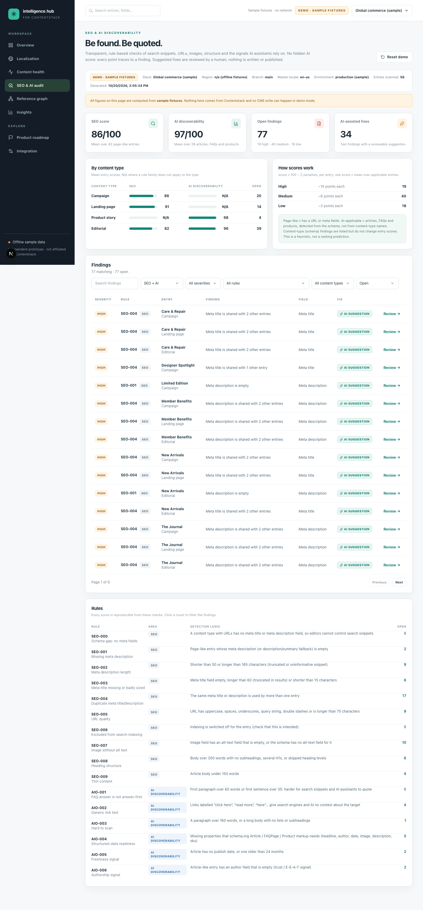

# SEO & AI discoverability audit (`/seo`)

A transparent, rule-based audit of search snippets, URLs, images, content structure and the signals AI assistants rely on. **There is no hidden AI score**: every point of every score traces to a finding with evidence and a "how to fix". AI is used only to *suggest* replacement text for meta fields, and a human reviews it.



## What it audits

The audit reads **master-locale** entries during the normal scan (no extra API calls). Entries are classified from the **schema**, never from content-type names, so it works on any stack:

| Class | Detected when | Rule families that apply |
|---|---|---|
| Page-like | has a URL field (`url`, `slug`, `path`, `permalink`) or meta fields | meta title/description, duplicates, URL quality, indexing |
| Article-like | page-like + a rich-text body + a date or author field | body structure, thin content, freshness, authorship, schema.org Article |
| FAQ-like | has a rich-text `answer` field | answer-first check, schema.org FAQPage |
| Product-like | has a `*_sku` text field | schema.org Product readiness |

Meta fields are found by name anywhere in the schema (including global fields and blocks): `meta_title`, `seo_title`, `seo.title`, `meta_description`, `seo_description`, `seo.description`. If a type has no meta description field, a top-level `description` / `summary` / `excerpt` / `teaser` is used as a fallback and labelled as such.

## Rules

| Rule | Area | Title | Detection logic |
|---|---|---|---|
| `SEO-000` | SEO | Schema gap: no meta fields | A content type with URLs has no meta title or meta description field, so editors cannot control search snippets |
| `SEO-001` | SEO | Missing meta description | Page-like entry whose meta description (or description/summary fallback) is empty |
| `SEO-002` | SEO | Meta description length | Shorter than 50 or longer than 165 characters (truncated or uninformative snippet) |
| `SEO-003` | SEO | Meta title missing or badly sized | Meta title field empty, longer than 60 (truncated in results) or shorter than 15 characters |
| `SEO-004` | SEO | Duplicate meta title/description | The same meta title or description is used by more than one entry |
| `SEO-005` | SEO | URL quality | URL has uppercase, spaces, underscores, query string, double slashes or is longer than 75 characters |
| `SEO-006` | SEO | Excluded from search indexing | Indexing is switched off for the entry (check that this is intended) |
| `SEO-007` | SEO | Image without alt text | Image field has an alt-text field that is empty, or the schema has no alt-text field for it |
| `SEO-008` | SEO | Heading structure | Body over 300 words with no subheadings, several H1s, or skipped heading levels |
| `SEO-009` | SEO | Thin content | Article body under 150 words |
| `AIO-001` | AI discoverability | FAQ answer is not answer-first | First paragraph over 60 words or first sentence over 35: harder for search snippets and AI assistants to quote |
| `AIO-002` | AI discoverability | Generic link text | Links labelled “click here”, “read more”, “here”… give search engines and AI no context about the target |
| `AIO-003` | AI discoverability | Hard to scan | A paragraph over 160 words, or a long body with no lists or subheadings |
| `AIO-004` | AI discoverability | Structured-data readiness | Missing properties that schema.org Article / FAQPage / Product markup needs (headline, author, date, image, description, sku) |
| `AIO-005` | AI discoverability | Freshness signal | Article has no publish date, or one older than 24 months |
| `AIO-006` | AI discoverability | Authorship signal | Article-like entry has an author field that is empty (trust / E-E-A-T signal) |

Severities: **high** (SEO-001, SEO-004), **medium** (most rules), **low** (URL quality, generic links, scannability, freshness, image-field schema gaps). Thresholds live in one place (`lib/domain/seo.ts`, `LIMITS`) and are intentionally conservative defaults, not search-engine guarantees.

## Scoring

```
entry score = max(0, 100 − Σ penalties)      high 15 · medium 8 · low 3
site score  = mean of entry scores over the entries the rule family applies to
```

- **SEO score** averages page-like entries; **AI discoverability** averages articles, FAQs and products.
- If nothing applies the score is **N/A**, never 100.
- Content-type (schema) findings (SEO-000, image fields without an alt-text field) are listed but do not change entry scores.
- It is a **heuristic for prioritising editorial work**, not a prediction of rankings or AI citations.

## AI suggestions (human-reviewed)

Findings about plain text meta fields (missing / wrong length / duplicate meta title or description) can get a suggestion:

1. **Generate**: demo mode uses simple, clearly labelled **simulated** text rules. Live mode calls OpenAI, which requires `AI_SEND_CONTENT_TO_OPENAI=true` and per-finding consent. Only the entry title, the current text and a short (≤500 character) excerpt are sent; never tokens or other entries. The prompt forbids inventing facts and states the target length.
2. **Edit**: the text is editable with a live character gauge against the target range.
3. **Approve / Reject**: a recorded decision with an audit trail. Approval is **not** a CMS write.
4. **Apply to demo** (demo only) re-audits the dataset and resolves the finding; in live mode you **copy the approved text** into Contentstack. Live write-back for SEO suggestions is intentionally not offered.

Model, env-configured reasoning effort, tokens and computed cost are recorded on every suggestion, exactly like translation proposals. Findings that need editorial or schema changes (headings, thin content, alt text, authorship…) show guidance instead of a suggestion.

## Try it

```bash
npm run dev                # /seo in demo or live mode
npm run live:seo           # read-only: scan the live stack and print counts and one example per rule
```

## Limits

- Master locale only; market-specific SEO (hreflang, localized meta) is covered only to the extent localized meta fields appear in the localization audit.
- It sees what is in the CMS: rendering, internal linking graph, Core Web Vitals, backlinks and actual search performance are out of scope.
- Duplicate detection compares normalised text across all page-like entries in the scan.
- Heading checks use the rich-text heading nodes; headings produced by templates are invisible to it.
- Alt text is checked when the schema has a sibling alt-text field; assets' own metadata is not read.

---
[← Back to README](../README.md) · [All documentation](README.md)
